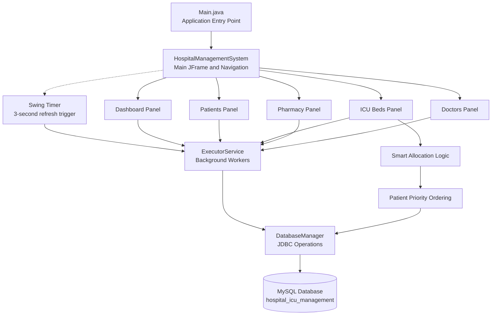
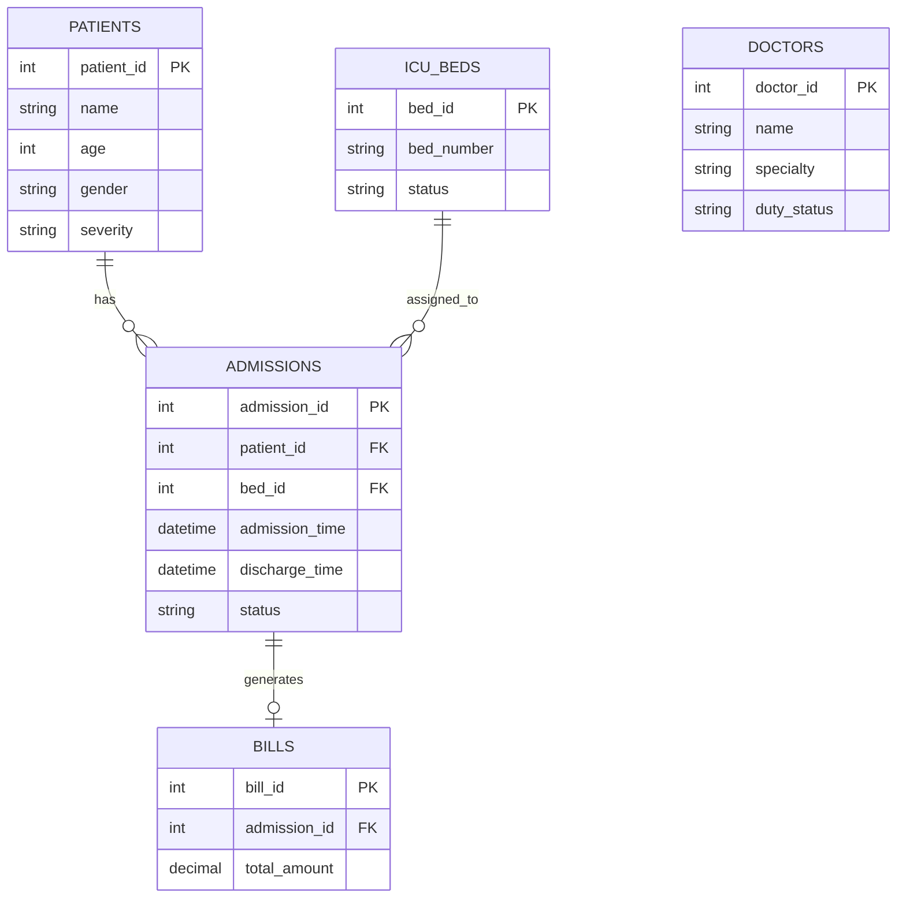

# 🏥 CarePoint — Ultimate Hospital Command

**A real-time, multithreaded Hospital and ICU Management System built with Java Swing and MySQL.**

CarePoint is a comprehensive desktop application designed to solve the real-world problem of hospital resource management. It provides a centralized view of critical hospital operations, allowing administrators and medical staff to track patient flow, manage ICU bed allocation, monitor pharmacy inventory, manage doctors, and calculate patient bills.

Unlike traditional systems that require manual refreshing, CarePoint is designed with a background synchronization mechanism that refreshes the application interface every 3 seconds. This helps keep displayed information up to date while keeping database operations separate from the Swing Event Dispatch Thread (EDT).

> **Disclaimer:** CarePoint is an educational and administrative software project, not a certified medical device or official hospital dispatch system. Its outputs do not guarantee real-world bed availability or medical decisions. Do not rely on this project for actual clinical triage, treatment decisions, or emergency dispatch.

---

## Table of Contents

1. [Project Overview](#project-overview)
2. [Features](#features)
3. [Technology Stack](#technology-stack)
4. [System Architecture](#system-architecture)
5. [Project Structure](#project-structure)
6. [Database Schema](#database-schema)
7. [Prerequisites](#prerequisites)
8. [Installation & Configuration](#installation--configuration)
9. [Running the Application](#running-the-application)
10. [Multithreading & Concurrency](#multithreading--concurrency)
11. [The Smart Allocation Algorithm](#the-smart-allocation-algorithm)
12. [Data and Persistence](#data-and-persistence)
13. [Error Handling and Validation](#error-handling-and-validation)
14. [Security Considerations](#security-considerations)
15. [Limitations](#limitations)
16. [Future Improvements](#future-improvements)
17. [Troubleshooting](#troubleshooting)
18. [Author](#author)

---

## Project Overview

During a hospital crisis or peak admission hours, staff need clear, up-to-date information about patient severity, ICU bed availability, doctor availability, and medicine inventory.

CarePoint explores how Java desktop applications, relational databases, and multithreading can assist with these administrative tasks.

The application uses **Java Swing/AWT** for its graphical user interface and **MySQL** for persistent relational data storage. JDBC provides database connectivity, while background task execution helps prevent long-running database operations from freezing the interface.

The project follows a modular design that separates interface components, database operations, hospital management logic, and application configuration.

### Project Objectives

- Simplify patient registration and record management.
- Display hospital and ICU resource availability.
- Prioritize patients waiting for ICU beds.
- Automate administrative bed allocation where appropriate.
- Maintain doctor duty information.
- Track pharmacy stock and identify low-stock medicines.
- Calculate billing based on recorded admission and discharge times.
- Provide a centralized dashboard for hospital operations.
- Demonstrate Java GUI development, JDBC, SQL, and concurrency concepts.

## Features

### 1. Live Command Dashboard

The dashboard provides a centralized overview of hospital activity.

- Total registered patients.
- Currently admitted patients.
- Patients with high or critical severity.
- Available ICU beds.
- Patients waiting for an ICU bed.
- ICU occupancy progress indicator.
- Live clock and periodic dashboard refresh.
- Quick access to the major application modules.

The dashboard is intended to help staff identify resource shortages and pending administrative tasks quickly.

### 2. Smart Triage and ICU Bed Allocation

CarePoint includes a priority-based allocation workflow for patients waiting for ICU beds.

- Supports CRITICAL, HIGH, MEDIUM, and LOW priority levels.
- Selects higher-priority patients before lower-priority patients.
- Checks whether an eligible bed is available before allocation.
- Updates the relevant patient and bed records.
- Supports automatic allocation when a bed becomes available, if enabled by the application logic.
- Refreshes the displayed bed status after allocation.

The allocation mechanism is an administrative demonstration. Actual ICU placement must be determined by qualified medical personnel using clinical assessments and hospital protocols.

### 3. Visual ICU Bed Map

The ICU module presents beds in a visual, color-coded layout.

- Displays occupied and available beds.
- Shows the patient assigned to an occupied bed, where supported.
- Uses severity-based colors to help distinguish patient categories.
- Highlights available beds.
- Updates the display following allocation and discharge operations.

Example color convention:

| Color | Meaning |
|---|---|
| Red | Critical patient |
| Orange | High-severity patient |
| Yellow | Medium-severity patient |
| Mint green | Available bed |
| Gray | Inactive or unavailable bed, if supported |

Colors are visual indicators only. They do not replace clinical assessments or formal hospital protocols.

### 4. Patient Directory

The patient management module provides patient record management.

- Register new patients.
- View patient information.
- Update existing patient details.
- Search or filter patient records, if implemented.
- Record age, gender, symptoms, and severity.
- Track admission status.
- Support discharge workflows.
- Maintain patient and admission history, where supported.

Patient registration and admission should be treated as separate operations when the system needs to distinguish registered patients from currently admitted patients.

### 5. Automated Billing

The billing functionality helps calculate administrative charges associated with a patient's stay.

- Records admission and discharge timestamps.
- Calculates the length of stay.
- Applies the configured ICU or hospital daily rate.
- Generates a bill when the patient is discharged, if configured.
- Supports review of the calculated amount before finalization.

A typical duration calculation is:

`Stay Duration = Discharge Time − Admission Time`

The final charge depends on the billing policy implemented by the application, including its rounding rules, applicable rates, and additional charges.

### 6. Doctor Management

The doctor management module maintains staff information relevant to hospital operations.

- Add and maintain doctor records.
- Record doctor names and specialties.
- Track duty status.
- Mark doctors as `ON_DUTY` or `OFF_DUTY`.
- Display current duty information.

A future extension can connect doctor availability to department, shift, workload, and patient assignment management.

### 7. Pharmacy Inventory

The pharmacy module provides medicine inventory tracking.

- Maintain medicine records.
- Track available quantities.
- Update stock after authorized inventory operations.
- Display low-stock warnings.
- Support stock replenishment.
- Help administrators identify medicines requiring attention.

Inventory warnings depend on configured minimum-stock thresholds. Stock tracking alone does not establish whether a medicine is clinically appropriate for a patient.

### 8. Database Manager

The database management module provides administrative operations for maintaining application records, where implemented.

- Manage selected patient records.
- Remove specific patient histories when permitted.
- Provide a database reset operation for development or demonstration environments.
- Help administrators manage application data without manually executing SQL statements.

**Important:** Destructive operations must require confirmation and appropriate authorization. A full database wipe should never be exposed as an unrestricted routine operation in a production hospital system.

### 9. Centralized Theme Engine

CarePoint uses a centralized theme configuration approach.

- Keep common interface colors in one place.
- Support consistent styling across application panels.
- Simplify changes to fonts, colors, and component appearance.
- Allow dark, light, or custom palettes where implemented.

The actual available themes depend on the application's `Theme.java` implementation.

### 10. Background Synchronization

The application is designed to periodically refresh relevant data.

- Refresh dashboard statistics.
- Update patient and bed displays.
- Reflect changes made by other application operations.
- Reduce the need for manual refreshing.
- Keep the Swing interface responsive by moving database work to background workers.

The refresh interval is configured as 3 seconds in the intended design. Refreshing the interface does not guarantee that every database transaction is immediately visible or that concurrent updates cannot occur.

---

## Technology Stack

| Technology | Purpose |
|---|---|
| Java 8+ | Core programming language |
| Java Swing | Desktop graphical user interface |
| Java AWT | Layouts, events, and graphical components |
| MySQL Server | Relational database |
| JDBC | Java-to-database connectivity |
| MySQL Connector/J | JDBC driver for MySQL |
| `ExecutorService` | Background task execution |
| `javax.swing.Timer` | Periodic UI refresh scheduling |
| SQL | Queries, updates, and relational data management |
| Mermaid | Documentation of system architecture |

### Why These Technologies?

**Java** provides object-oriented programming and a mature ecosystem for desktop application development.

**Swing/AWT** provides the components needed to build a desktop interface, including tables, buttons, forms, panels, and dialogs.

**MySQL** stores hospital records persistently rather than relying exclusively on in-memory data.

**JDBC** allows Java classes to execute parameterized SQL queries and retrieve database results.

**ExecutorService** helps execute time-consuming operations outside the Swing Event Dispatch Thread.

**Swing Timer** schedules periodic callbacks on the EDT. It should be used to trigger asynchronous refresh work, not to execute blocking SQL operations directly.

---

## System Architecture

CarePoint follows a modular architecture based on separation of concerns.

The user interface handles interaction and presentation. Background workers execute time-consuming tasks. The database layer manages JDBC operations, and MySQL stores persistent records.



### Architecture Layers

**1. Presentation Layer**

Contains Swing frames, panels, tables, forms, dialogs, and visual components. It collects user input and presents retrieved information.

**2. Application Logic Layer**

Handles workflows such as patient registration, admission, discharge, priority ordering, bed allocation, and billing calculations.

**3. Concurrency Layer**

Schedules database operations away from the EDT and coordinates background tasks with UI updates.

**4. Data Access Layer**

Contains JDBC operations, SQL queries, connection handling, and database-related error handling.

**5. Database Layer**

Stores persistent patient, bed, doctor, pharmacy, admission, and billing information.

### Important Design Principle

The interface should not execute slow SQL queries directly on the EDT. Background workers should perform database operations, and Swing components should be updated on the EDT after those operations complete.

This separation helps the application remain responsive under normal workloads.

---

## Project Structure

The following is a **proposed logical project structure** for a maintainable CarePoint implementation. Adapt the filenames to match the actual repository.

```text
CarePoint/
│
├── src/
│   └── com/
│       └── carepoint/
│           │
│           ├── Main.java
│           ├── HospitalManagementSystem.java
│           │
│           ├── config/
│           │   ├── DatabaseConfig.java
│           │   └── Theme.java
│           │
│           ├── database/
│           │   ├── DatabaseManager.java
│           │   └── DatabaseInitializer.java
│           │
│           ├── models/
│           │   ├── Patient.java
│           │   ├── Doctor.java
│           │   ├── Bed.java
│           │   ├── Medicine.java
│           │   ├── Admission.java
│           │   └── Bill.java
│           │
│           ├── dao/
│           │   ├── PatientDAO.java
│           │   ├── DoctorDAO.java
│           │   ├── BedDAO.java
│           │   ├── MedicineDAO.java
│           │   ├── AdmissionDAO.java
│           │   └── BillDAO.java
│           │
│           ├── services/
│           │   ├── PatientService.java
│           │   ├── BedAllocationService.java
│           │   ├── BillingService.java
│           │   └── PharmacyService.java
│           │
│           ├── ui/
│           │   ├── DashboardPanel.java
│           │   ├── PatientsPanel.java
│           │   ├── ICUBedsPanel.java
│           │   ├── DoctorsPanel.java
│           │   ├── PharmacyPanel.java
│           │   └── DatabaseManagerPanel.java
│           │
│           └── utils/
│               ├── DateTimeUtils.java
│               └── ValidationUtils.java
│
├── resources/
│   ├── icons/
│   └── images/
│
├── sql/
│   ├── schema.sql
│   └── sample_data.sql
│
├── lib/
│   └── mysql-connector-j.jar
│
├── tests/
│
├── .gitignore
├── README.md
└── LICENSE
```

### Responsibilities of Major Files

| File or package | Responsibility |
|---|---|
| `Main.java` | Starts the application and initializes the interface. |
| `HospitalManagementSystem.java` | Hosts the main frame and navigation. |
| `Theme.java` | Centralizes interface colors and styles. |
| `DatabaseManager.java` | Handles database connectivity and shared JDBC utilities. |
| `models/` | Represents entities such as patients, doctors, and beds. |
| `dao/` | Encapsulates database queries and persistence operations. |
| `services/` | Implements hospital workflows and business rules. |
| `ui/` | Contains Swing panels and interaction logic. |
| `sql/schema.sql` | Defines database tables and constraints. |
| `sql/sample_data.sql` | Provides optional demonstration data. |

A DAO/service separation is recommended because it makes database logic easier to test and reduces duplication across UI panels. It is not necessary to create every listed file if the existing implementation uses a different structure.

---

## Database Schema

CarePoint uses MySQL as its relational persistence layer. The exact schema depends on the SQL tables created in the project.

The following is a representative database design for the features described in this README, not a claim that every table already exists in the current implementation.

### 1. Patients

Stores basic patient information.

| Column | Purpose |
|---|---|
| `patient_id` | Unique patient identifier |
| `name` | Patient name |
| `age` | Patient age |
| `gender` | Recorded gender |
| `symptoms` | Reported symptoms |
| `severity` | Administrative priority category |
| `created_at` | Registration timestamp |

### 2. ICU Beds

Stores information about available and occupied beds.

| Column | Purpose |
|---|---|
| `bed_id` | Unique bed identifier |
| `bed_number` | Human-readable bed number |
| `bed_type` | ICU or another supported bed category |
| `status` | Available, occupied, or unavailable |
| `patient_id` | Current patient reference, if the design uses this relationship |

### 3. Doctors

Stores doctor information.

| Column | Purpose |
|---|---|
| `doctor_id` | Unique doctor identifier |
| `name` | Doctor name |
| `specialty` | Medical specialty |
| `duty_status` | On-duty or off-duty status |

### 4. Pharmacy Inventory

Stores medicine and stock information.

| Column | Purpose |
|---|---|
| `medicine_id` | Unique medicine identifier |
| `medicine_name` | Medicine name |
| `quantity` | Available stock |
| `minimum_stock` | Low-stock warning threshold |
| `unit_price` | Configured unit price, if billing uses it |

### 5. Admissions

An admissions table is recommended when patients may be admitted, discharged, and readmitted over time.

| Column | Purpose |
|---|---|
| `admission_id` | Unique admission identifier |
| `patient_id` | Associated patient |
| `bed_id` | Assigned bed, if applicable |
| `admission_time` | Admission timestamp |
| `discharge_time` | Discharge timestamp |
| `status` | Current admission status |

### 6. Bills

A separate billing table is recommended for maintaining financial history.

| Column | Purpose |
|---|---|
| `bill_id` | Unique bill identifier |
| `admission_id` | Associated admission |
| `stay_duration` | Calculated duration |
| `total_amount` | Final calculated charge |
| `created_at` | Bill generation timestamp |

### Relationships



The relationship diagram describes a recommended design. The actual application may use different table names, direct patient-to-bed relationships, or a different billing structure.

### Database Design Recommendations

- Use primary keys to identify records uniquely.
- Use foreign keys to maintain referential integrity.
- Use transactions for operations that change multiple related records.
- Add indexes to columns frequently used for searching and joining.
- Store timestamps consistently.
- Avoid deleting historical admissions when a patient is discharged.
- Enforce valid status values through constraints or application-level validation.
- Ensure bed allocation cannot assign one occupied bed to two active admissions.

---

## Prerequisites

Before running CarePoint, install and configure the following.

### Required Software

1. **Java Development Kit (JDK):** Java 8 or later, compatible with the source code.
2. **MySQL Server:** A running MySQL instance.
3. **MySQL Connector/J:** The JDBC driver compatible with your MySQL and Java versions.
4. **IDE or Java build tools:** IntelliJ IDEA, Eclipse, NetBeans, or the command-line Java compiler.

### Verify Java

Open a terminal or command prompt and run:

```bash
java -version
javac -version
```

Both commands should display a compatible Java version. If `javac` is not recognized, install a JDK and configure `JAVA_HOME` and your system PATH.

### Verify MySQL

Log in using your MySQL client:

```bash
mysql -u root -p
```

Enter your password when prompted.

The exact commands and setup steps may differ depending on your operating system and installation method.

---

## Installation & Configuration

### Step 1: Obtain the Project

If the project is hosted on GitHub, clone the repository:

```bash
git clone <YOUR_REPOSITORY_URL>
cd CarePoint
```

Replace `<YOUR_REPOSITORY_URL>` with the actual repository URL. If the project is already on your computer, open its existing directory instead.

### Step 2: Create the Database

Log in to MySQL and create the database:

```sql
CREATE DATABASE hospital_icu_management;
```

Select it:

```sql
USE hospital_icu_management;
```

If the project includes a schema file, import that file to create the required tables. For example, from a terminal:

```bash
mysql -u root -p hospital_icu_management < sql/schema.sql
```

Run the command from the directory containing `sql/schema.sql`. If your project does not have this file, use the SQL schema that actually exists in your project.

### Step 3: Configure Database Credentials

Configure the application's JDBC connection settings.

A typical JDBC URL is:

```text
jdbc:mysql://localhost:3306/hospital_icu_management
```

The connection also requires a MySQL username and password.

For example, a development configuration might use:

```java
String url =
    "jdbc:mysql://localhost:3306/hospital_icu_management";

String username = System.getenv("DB_USER");
String password = System.getenv("DB_PASSWORD");
```

Set the environment variables before launching the application. Do not commit real database passwords to a public repository.

The example assumes the application reads credentials from environment variables. Adapt it if the existing `DatabaseManager.java` uses a different configuration mechanism.

### Step 4: Add MySQL Connector/J

Ensure that the MySQL JDBC driver is available on the application's classpath.

If the project uses an IDE, add the Connector/J dependency through its project settings.

If the project uses a local JAR, add the correct JAR to the classpath. The exact setup differs between Windows, Linux, macOS, and IDE-based builds.

### Step 5: Initialize the Database

Confirm that:

- MySQL is running.
- The database exists.
- Required tables have been created.
- The configured user has appropriate permissions.
- The JDBC driver is available.
- The application uses the correct connection URL and credentials.

If the project contains an initialization utility, use it according to its implementation.

---

## Running the Application

### Option A: Run Through an IDE

1. Open the project in your Java IDE.
2. Configure the JDK.
3. Add the MySQL Connector/J dependency.
4. Configure the database credentials.
5. Ensure the MySQL service is running.
6. Locate the class containing `public static void main(String[] args)`.
7. Run that class.

The main application window should appear if initialization completes successfully.

### Option B: Run From the Command Line

The following example applies to a simple Java project whose sources are under `src/` and whose entry point is `com.carepoint.Main`. Change the paths and package name to match your project.

Compile on Windows:

```bat
javac -cp ".;lib/mysql-connector-j.jar" ^
  -d out src\com\carepoint\*.java
```

Compile on Linux or macOS:

```bash
javac -cp ".:lib/mysql-connector-j.jar" \
  -d out src/com/carepoint/*.java
```

These commands compile only the source files matched by the shown wildcard. If your project contains subpackages, compile all required source files or use your IDE/build system.

Run on Windows:

```bat
java -cp "out;lib/mysql-connector-j.jar" com.carepoint.Main
```

Run on Linux or macOS:

```bash
java -cp "out:lib/mysql-connector-j.jar" com.carepoint.Main
```

If your project uses a different entry-point class or package, replace `com.carepoint.Main` accordingly.

### Basic Verification Checklist

After launching the application, verify:

- The main window opens.
- Database connectivity succeeds.
- Dashboard statistics load.
- Patient records can be viewed.
- A test patient can be registered.
- ICU bed status displays correctly.
- Allocation respects bed availability and patient priority.
- Doctor duty status updates correctly.
- Pharmacy quantities and warnings behave as expected.
- Billing calculations use the configured rates and timestamps.
- The interface remains responsive during data refresh.

Use test data rather than real patient information.

---

## Multithreading & Concurrency

Multithreading helps CarePoint perform background operations without blocking the graphical interface.

### 1. Swing Event Dispatch Thread

Swing components are generally created and updated on the Event Dispatch Thread (EDT).

Long-running database operations on the EDT can cause:

- Frozen windows.
- Delayed button responses.
- Unresponsive tables.
- Poor user experience during slow queries.

For this reason, database work should run on background workers.

### 2. ExecutorService

`ExecutorService` can manage background tasks for database access, data loading, and other time-consuming operations.

Conceptually, the workflow is:

1. A user requests data or performs an action.
2. The application schedules the database operation on a worker thread.
3. The worker retrieves or updates data.
4. The result is passed back to the EDT.
5. Swing components display the result.

### 3. Three-Second Refresh Cycle

The application uses a 3-second refresh interval in its intended design.

A safe refresh workflow is:

1. A `javax.swing.Timer` fires on the EDT.
2. The timer submits a refresh task to the background executor.
3. The worker queries the required data.
4. The results are returned to the EDT.
5. The UI is updated with the latest retrieved values.

The timer itself does not make SQL execution asynchronous. That depends on submitting the database work to a worker.

### 4. Example Refresh Pattern

The following is a conceptual Java example, not a replacement for the existing application code.

```java
private final ExecutorService executor =
        Executors.newFixedThreadPool(3);

private final Timer refreshTimer =
        new Timer(3000, event -> {
    executor.submit(() -> {
        DashboardData data = loadDashboardData();

        SwingUtilities.invokeLater(() -> {
            updateDashboard(data);
        });
    });
});
```

This example assumes that `DashboardData`, `loadDashboardData()`, and `updateDashboard()` are implemented elsewhere. Production code should also handle exceptions, executor shutdown, and overlapping refresh tasks.

### 5. Concurrency Challenges

Concurrent operations require particular care when multiple staff actions affect the same patient or bed.

Potential issues include:

- Two users attempting to allocate the same bed.
- A stale UI showing a bed as available after another operation has occupied it.
- Duplicate admissions caused by repeated submissions.
- Conflicting updates to patient status.
- Refresh tasks finishing out of order.
- Excessive database queries caused by frequent polling.

### 6. Recommended Safeguards

- Perform allocation checks and updates inside a database transaction.
- Use appropriate database constraints and row-level locking where needed.
- Avoid sharing JDBC `Connection`, `Statement`, or `ResultSet` objects unsafely across threads.
- Use prepared statements for parameterized queries.
- Prevent or coalesce overlapping refresh tasks.
- Keep Swing component updates on the EDT.
- Shut down background executors when the application closes.
- Handle exceptions without silently losing important operation failures.

A 3-second polling interval provides periodic updates, not guaranteed instantaneous synchronization. A production deployment may require a different synchronization strategy.

---

## The Smart Allocation Algorithm

The smart allocation feature prioritizes patients waiting for ICU beds and attempts to assign an available bed to the highest-priority eligible patient.

### Priority Order

The configured priority order is:

1. `CRITICAL`
2. `HIGH`
3. `MEDIUM`
4. `LOW`

Priority levels should be validated so that unknown values cannot accidentally receive the highest priority.

### Allocation Workflow

1. Retrieve patients who are eligible and waiting for an ICU bed.
2. Retrieve eligible, currently available ICU beds.
3. Order the waiting patients by severity priority.
4. Apply a consistent tie-breaking rule, such as earliest waiting time.
5. Select a compatible available bed.
6. Atomically verify availability and update the allocation.
7. Update the patient's admission or allocation status.
8. Refresh the dashboard, bed map, and waiting list.

If no suitable bed is available, the patient remains on the waiting list. The application should report the reason rather than silently dropping the patient.

### Pseudocode

```text
function allocateNextPatient():

    waitingPatients = getEligibleWaitingPatients()
    availableBeds = getEligibleAvailableBeds()

    sort waitingPatients by:
        severity priority descending
        waiting time ascending

    for each patient in waitingPatients:

        bed = findCompatibleAvailableBed(patient, availableBeds)

        if bed exists:

            begin transaction

            verify bed is still available
            verify patient is still eligible

            assign bed to patient
            update allocation status

            commit transaction

            refresh affected views
            return successful allocation

            if any operation fails:
                rollback transaction

    return no suitable allocation
```

This is a conceptual algorithm. The exact ordering, compatibility rules, and transaction implementation depend on the application code.

### Example

Suppose the waiting list contains:

| Patient | Priority | Waiting time |
|---|---|---|
| Patient A | HIGH | 15 minutes |
| Patient B | CRITICAL | 4 minutes |
| Patient C | MEDIUM | 25 minutes |

If one eligible ICU bed becomes available, Patient B is considered first because CRITICAL has the highest configured priority.

This example demonstrates administrative priority ordering only. It is not a validated clinical triage protocol.

### Important Edge Cases

A robust allocation implementation should account for:

- No available beds.
- No eligible patients waiting.
- Multiple patients with the same priority.
- Bed compatibility requirements.
- Beds marked unavailable for maintenance.
- A patient being discharged while allocation is running.
- A bed becoming occupied by another operation.
- A patient who is no longer eligible for allocation.
- Database failures during allocation.
- Repeated allocation attempts for the same patient.
- Failed allocation updates and transaction rollbacks.

### Allocation Invariants

The system should maintain these conditions:

- A bed must not have two simultaneous active allocations.
- A patient must not receive duplicate active allocations.
- Only eligible beds may be assigned.
- Failed allocation transactions must not leave inconsistent records.
- A patient who cannot be allocated must remain visible for appropriate follow-up.

These safeguards are essential because displaying a green bed indicator is not sufficient to establish that the bed can safely be allocated.

---

## Data and Persistence

CarePoint uses MySQL to retain application records between sessions.

### Persistent Data

Depending on the implemented schema, persistent records may include:

- Patient details.
- Admission and discharge records.
- ICU bed status.
- Doctor information and duty status.
- Pharmacy stock.
- Billing records.
- Historical administrative information.

### Database Operations

The application may perform the following operations:

- `INSERT` — create a record.
- `SELECT` — retrieve records.
- `UPDATE` — change a record.
- `DELETE` — remove a record when permitted.

Database operations should use prepared statements and appropriate transaction boundaries.

### Why Persistence Matters

Without database persistence, in-memory changes can disappear when the application closes. MySQL allows records to be retrieved in later sessions and supports relational integrity between associated entities.

### Transactional Workflows

Some operations involve multiple changes that must succeed together.

For example, a bed allocation may require:

1. Verifying the bed is available.
2. Assigning the bed.
3. Updating the patient's allocation status.
4. Creating or updating the admission record.

If one required operation fails, the transaction should be rolled back to prevent inconsistent data.

Similarly, discharge and billing workflows should be designed to avoid duplicate bills and incomplete status changes.

### Backup and Recovery

For a real deployment, database backup and recovery procedures should be established before operational use.

Development reset functionality must not be confused with a reliable backup, recovery, or archival system.

---

## Error Handling and Validation

A hospital management application should reject invalid input and clearly communicate failures.

### Input Validation

Recommended validation rules include:

- Patient names must not be blank.
- Age must fall within the application's accepted range.
- Required patient details must be provided.
- Severity must belong to a supported set of values.
- Medicine quantities must not be negative.
- Prices and billing amounts must be valid.
- Doctor duty status must use supported values.
- Admission and discharge timestamps must be consistent.
- Bed assignment must reference a valid, eligible bed.

### Database Error Handling

The application should handle failures such as:

- Database server unavailable.
- Incorrect credentials.
- Missing tables.
- Duplicate identifiers.
- Foreign-key violations.
- Failed transactions.
- Query timeouts.
- Lost connections.

Errors should be logged with enough context for debugging without exposing passwords or sensitive patient information.

### User Feedback

A good interface should distinguish between:

- Successful operations.
- Validation errors.
- Operations that are still processing.
- Database failures.
- Allocation failures.
- Operations requiring administrator approval.

The UI should not report an operation as successful until the relevant database operation has actually succeeded.

---

## Security Considerations

CarePoint is an educational project, but its design should demonstrate sound security practices.

### Database Credentials

- Avoid committing passwords to source control.
- Use environment variables or a suitable configuration mechanism.
- Restrict database permissions to the operations the application needs.
- Avoid using an unrestricted MySQL root account for routine application access.

### SQL Safety

- Prefer `PreparedStatement` for parameterized SQL.
- Validate input before processing it.
- Avoid building SQL queries by concatenating untrusted input.
- Apply database constraints to protect data integrity.

### Patient Privacy

- Use synthetic patient information for demonstrations.
- Avoid publishing actual patient records in GitHub repositories, screenshots, or logs.
- Restrict access to patient and billing information.
- Consider audit logs for sensitive administrative operations.

### Destructive Operations

- Require explicit confirmation before deleting records.
- Restrict database reset functionality to authorized development or administrative workflows.
- Protect historical records when they are required for audit or billing purposes.
- Maintain verified backups before destructive maintenance.

### Production Readiness

This project should not be considered production-ready solely because it connects to MySQL or supports multiple threads. A real hospital deployment would require substantial security, reliability, privacy, testing, and regulatory review.

---

## Limitations

CarePoint is a demonstration of hospital resource management and Java desktop application development. The following limitations should be considered.

### 1. Clinical Decision Support

Priority-based sorting is not equivalent to clinically validated triage. The software cannot independently determine medical urgency or make treatment decisions.

### 2. Real-Time Synchronization

A periodic 3-second refresh can display changes with a delay. It does not guarantee instant consistency across multiple computers or application instances.

### 3. Concurrent Bed Allocation

Correct allocation under concurrent access requires database transactions, constraints, and suitable locking. UI-level availability checks alone are insufficient.

### 4. Staff Scheduling

Doctor duty status is not equivalent to a complete staffing system. Shift scheduling, workload, leave management, and skill-based assignment may require additional implementation.

### 5. Pharmacy Management

Stock quantities and low-stock warnings do not constitute a complete pharmacy system. Expiry tracking, batch numbers, dispensing records, and controlled stock procedures may require additional functionality.

### 6. Billing Rules

Billing accuracy depends on the implemented rate configuration, time calculations, rounding rules, and charge policies.

### 7. Authentication and Authorization

If the current application does not include role-based access control, users may not have sufficiently differentiated permissions for administrative operations.

### 8. Backup and Auditability

A database wipe or record deletion feature is not a substitute for audit trails, reliable backups, and recovery procedures.

### 9. Deployment Scope

A Swing desktop application connected to a local MySQL instance is different from a secure, distributed hospital information system.

These limitations define areas for further development and testing.

---

## Future Improvements

CarePoint can be extended into a more complete hospital administration platform.

The following items are **proposed enhancements**, not claims that they are already implemented.

### 1. Advanced Patient Admission Management

- Separate patient registration from admission.
- Support multiple admissions for the same patient.
- Track admission, transfer, discharge, and readmission history.
- Validate admission status transitions.
- Prevent duplicate active admissions.
- Track the current ward, room, and bed.

### 2. More Robust ICU Bed Management

- Support multiple wards and ICU categories.
- Record bed maintenance and temporary unavailability.
- Track isolation and equipment requirements.
- Prevent double allocation through database constraints and transactions.
- Display bed occupancy and waiting time statistics.
- Support transfer requests between beds or wards.

### 3. Improved Allocation and Waiting Lists

- Add configurable tie-breaking rules.
- Track how long each patient has been waiting.
- Explain why an allocation attempt failed.
- Maintain an auditable allocation history.
- Add manual review and authorized override workflows.
- Support compatibility checks for bed categories.

Any automated priority logic must remain subordinate to qualified clinical judgment.

### 4. Doctor and Staff Scheduling

- Introduce shift scheduling.
- Track leave and availability periods.
- Display department-wise staffing.
- Prevent assignments to unavailable staff.
- Add workload and assignment history.
- Support nursing staff and other hospital personnel.

### 5. Expanded Pharmacy Management

- Track medicine batch numbers.
- Record expiry dates.
- Generate expiry and low-stock alerts.
- Maintain supplier information.
- Record stock purchases and adjustments.
- Track authorized medicine issue and return operations.
- Add inventory audit history.

### 6. Enhanced Billing and Payments

- Support itemized invoices.
- Add configurable ward and ICU rates.
- Track additional services and charges.
- Prevent duplicate billing.
- Record payment status.
- Generate printable invoices.
- Maintain billing adjustments and audit history.

### 7. User Authentication and Role-Based Access

- Add secure login.
- Introduce administrator, doctor, nurse, pharmacist, and reception roles.
- Restrict sensitive operations by role.
- Record important administrative actions.
- Add session management and secure credential handling.

### 8. Reports and Analytics

- Generate daily, weekly, and monthly admission reports.
- Display bed occupancy trends.
- Analyze average length of stay.
- Track waiting-list statistics.
- Generate low-stock and medicine expiry reports.
- Export authorized reports to CSV or PDF.
- Add filters for date, ward, severity, and admission status.

### 9. Better Notifications

- Add in-app notifications for important changes.
- Alert authorized staff about bed availability.
- Notify pharmacy staff about low stock.
- Highlight pending discharge and billing tasks.
- Add configurable alert thresholds.

Notifications should be reliable, appropriately authorized, and designed to avoid overwhelming staff.

### 10. Database and Performance Improvements

- Add connection pooling where appropriate.
- Optimize frequent SQL queries.
- Add indexes to frequently searched columns.
- Prevent overlapping background refresh tasks.
- Reduce unnecessary polling.
- Improve transaction management.
- Add structured logging and error monitoring.

### 11. Automated Testing

- Add unit tests for allocation and billing rules.
- Add integration tests for JDBC operations.
- Test duplicate and concurrent bed allocation.
- Test admission and discharge workflows.
- Test invalid input and database failures.
- Add regression tests for previously discovered bugs.
- Test application shutdown while background tasks are active.

### 12. Modernized User Experience

- Improve accessibility and keyboard navigation.
- Add consistent loading and error states.
- Improve search and filtering.
- Add responsive panel layouts.
- Improve empty-state messages.
- Provide configurable light and dark themes.
- Improve table sorting and patient record navigation.

### 13. Deployment and Maintenance

- Introduce a repeatable build process.
- Package the application for easier installation.
- Document configuration and upgrades.
- Add a controlled database migration process.
- Establish backup and restoration procedures.
- Provide sample data for demonstrations.
- Separate development configuration from production configuration.

---

## Troubleshooting

### Application Does Not Start

**Possible causes:**

- Incorrect JDK configuration.
- Missing JDBC driver.
- Incorrect main class.
- Compilation errors.
- Missing resources.

**Suggested checks:**

```bash
java -version
javac -version
```

Review the IDE console or terminal output for the first error reported.

### MySQL Connection Fails

**Possible causes:**

- MySQL is not running.
- Database name is incorrect.
- Username or password is incorrect.
- JDBC driver is missing.
- Port or connection URL is incorrect.

Confirm that the database exists and that the configured database user can connect to it.

### Dashboard Shows No Data

Check that:

- The expected tables exist.
- The database contains the required records.
- Queries use the correct table and column names.
- Database exceptions are not being swallowed.
- The refresh task is running and its results are being applied to the UI.

An empty database may legitimately produce zero counts.

### ICU Bed Is Available but No Patient Gets Assigned

Check the complete allocation workflow rather than only the displayed bed color.

Verify that:

1. The bed is actually marked available in MySQL.
2. The patient is present in the waiting list.
3. The patient's status permits allocation.
4. The priority value is recognized.
5. The bed meets any eligibility requirements.
6. The allocation transaction succeeds.
7. The patient and bed records are updated consistently.
8. The UI refreshes after the transaction.
9. No concurrent operation has already assigned the bed.

A green bed indicator does not prove that all allocation preconditions have been satisfied.

### Interface Freezes During Refresh

Check whether database calls are running on the EDT. Move long-running work to background workers and update Swing components on the EDT after the result is available.

### Duplicate Records or Conflicting Bed Assignments

Review unique constraints, foreign keys, transaction boundaries, and concurrency control. Disabling a UI button alone is not sufficient protection against concurrent database operations.

---

## Author

**CarePoint — Ultimate Hospital Command**

Developed as an educational project demonstrating:

- Java and object-oriented programming.
- Java Swing/AWT desktop development.
- MySQL and JDBC integration.
- Multithreaded task execution.
- Hospital resource management workflows.
- Priority-based ICU bed allocation.
- Relational data persistence.
- Modular software architecture.

**Project status:** Educational project under development.

**Technology:** Java, Swing/AWT, MySQL, JDBC.

> CarePoint is intended for learning, experimentation, and demonstration. It is not a substitute for a certified hospital information system, qualified medical personnel, or established clinical protocols.
